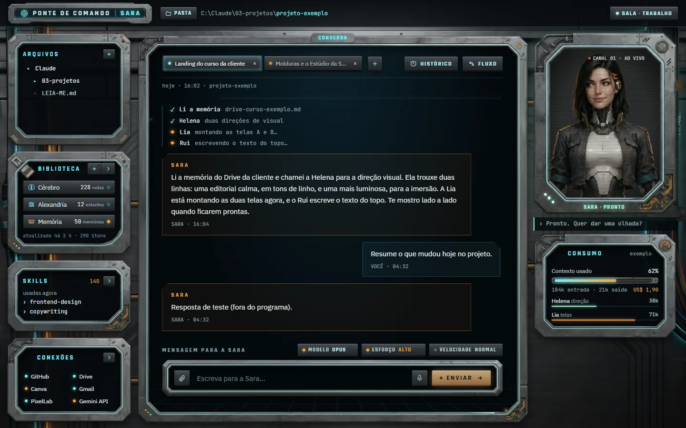
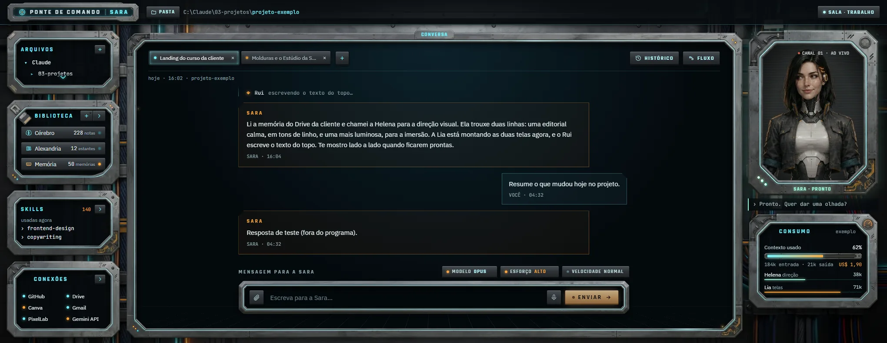
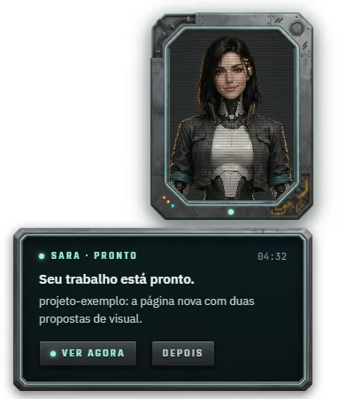

# Ponte de Comando · Sara

Programa para Windows (Tauri 2) que acompanha o Claude Code: conversa com permissão em português, árvore de arquivos, consumo de tokens e uma miniatura da Sara no canto da tela que avisa quando o trabalho fica pronto.

**Estado:** parado (desde nov/2026). A versão 0.1.1 chegou a ser instalada e usada; o trabalho parou no meio do modo "controle total com guarda". Última mudança: 06/11/2026 (ramo `pausa/2026-11-06-correcoes-qa`, commit `bd63967`, marcado como não testado).

## Prints







Tirados em 27/11/2026 das páginas da interface no navegador, com a ponte de mentira dos testes (`ferramentas/testes/paginas.mjs`), não do programa instalado. Os nomes e caminhos do exemplo foram trocados por genéricos antes da foto.

## O que tem pronto

No ramo `master`:

- **Carregamento** de pelo menos 8 s, depois a janela principal e a miniatura. Fechar só esconde; o programa fica na bandeja (Abrir, Mostrar/Esconder a miniatura, Silenciar, Sair).
- **Conversa de verdade** com o Claude Code por um sidecar Node com o Claude Agent SDK: uma sessão por aba, cada uma com modelo, esforço e velocidade; resposta aparecendo enquanto é escrita; PARAR sem perder a conversa.
- **Cartão de permissão** em português antes de qualquer ação. O programa nunca age sem pedir.
- **Pasta de trabalho** trocável, árvore de arquivos real (uma pasta por vez) e criar pasta ou arquivo sem sobrescrever. Apagar não existe.
- **Miniatura** sempre por cima, com o estado (esperando, trabalhando, precisa de você, pronto, erro), som curto, notificação do Windows e canto que gruda onde foi solto.
- **Avisos de conversas de fora** (terminal, VS Code) pelos hooks do Claude Code e pelas sessões em `~/.claude/sessions`.
- **Consumo**: tokens e custo estimado por conversa, subagente, modelo e skill; limites de 5 h e 7 dias; relógio do cache.
- **Testes**: `node:test` + `cargo test`, teste do `.exe` de verdade em pasta isolada, sidecar real, Job Object e as páginas no navegador.

No ramo `pausa/2026-11-06-correcoes-qa` (sem merge no `master`): correções do relatório de QA (`docs/qa/`), configurações em 7 seções, temas, conta (assinatura ou chave no Cofre) e o começo da guarda.

## Onde parou e próximo passo

Do `docs/ONDE-PARAMOS.md` do ramo de pausa:

1. Terminar e testar a guarda (`sidecar/guarda.mjs`): o cartão só aparece nos grupos de risco (apagar em massa, sistema, segurança, segredos, mandar dados para fora, persistência, coisa baixada, áreas protegidas), sempre pelo `canUseTool`, nunca `bypassPermissions`. Hoje está escrita e **não testada**.
2. Fechar a tela "Controle total com guarda / Pedir sempre", o "ver o registro" e o "restaurar padrão".
3. Auditoria de segurança do código de conta e cofre (`cofre.rs`, comandos `conta_*`, `sidecar/regras.mjs`, capabilities, CSP) antes de instalar.
4. Rodar de novo as baterias de QA (ciclo, CPU, servidor, arquivos-config, duas sessões, vazamento).
5. Merge no `master` → instalador 0.1.2.
6. Depois: telas para os dados que o backend já tem (mapa de agentes, limites, relógio do cache, conversas antigas), diff e terminal visível.

Para retomar: `git switch pausa/2026-11-06-correcoes-qa` e ler `docs/ONDE-PARAMOS.md`.

## Como rodar

Precisa de Rust (MSVC), VS Build Tools, WebView2, Node 24 e o Claude Code instalado com login feito. Sem o Node, a conversa cai para o `claude -p`, sem cartão de permissão.

```bash
npm install                                    # uma vez: o CLI do Tauri
npm --prefix sidecar install --omit=optional   # uma vez: o Claude Agent SDK do sidecar
npm run dev                                    # compila e abre o programa
npm run build                                  # gera o instalador NSIS
npm run sincronizar-ui                         # recopia a interface do protótipo
npm run testar                                 # node:test + cargo test
npm run testar:paginas                         # as páginas no navegador, em 2040×790 e 1440×900
npm run testar:programa                        # o .exe de verdade, isolado (gasta centavos com Haiku)
```

Para atualizar uma versão instalada, saia pela bandeja antes. Se o Smart App Control barrar o executável sem assinatura, não contorne: a solução é assinar o código (ver `docs/P00.md`). O hook do Claude Code e o teste dele estão em `docs/hooks.md`.

## Stack e pastas

Tauri 2 (Rust) + interface HTML/JS + sidecar Node com `@anthropic-ai/claude-agent-sdk`.

```
src-tauri/    janelas, bandeja, comandos, servidor dos hooks, conversa, tokens (Rust)
sidecar/      o processo Node com o Claude Agent SDK
ui/           interface: estudio/ (cópia do protótipo), ponte.js (contrato), ponte-main.js, mini.html
ferramentas/  hook do Claude Code, testes, sincronizar-ui, ícone, servidor da ui
docs/         P00 (fases e decisões), ponte.md (contrato window.ponte), hooks.md, capturas/, pesquisa/, prints/
```

O detalhe de cada arquivo está na tabela "Onde fica cada coisa" do `LEIA-ME.md`.

## Licença e créditos

Avisos de terceiros em `NOTICE.md`: a contagem de tokens e a tabela de preços vêm do `painel-tokens-claude-vscode` (MIT); o sidecar usa o Claude Agent SDK, com os termos da Anthropic (não redistribuído no repositório); Tauri e crates oficiais em MIT/Apache-2.0.
